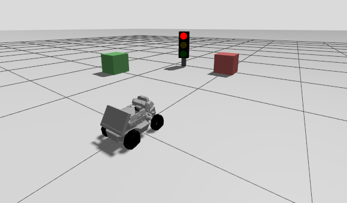
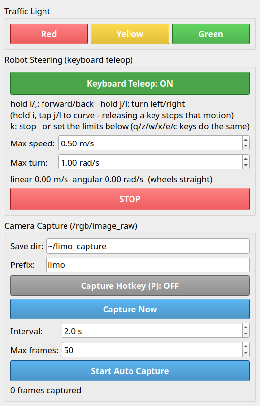
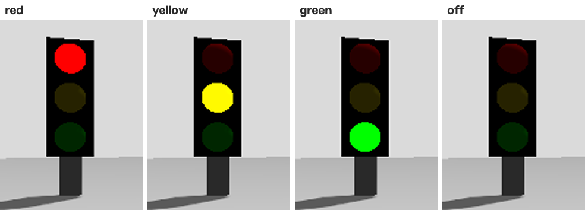
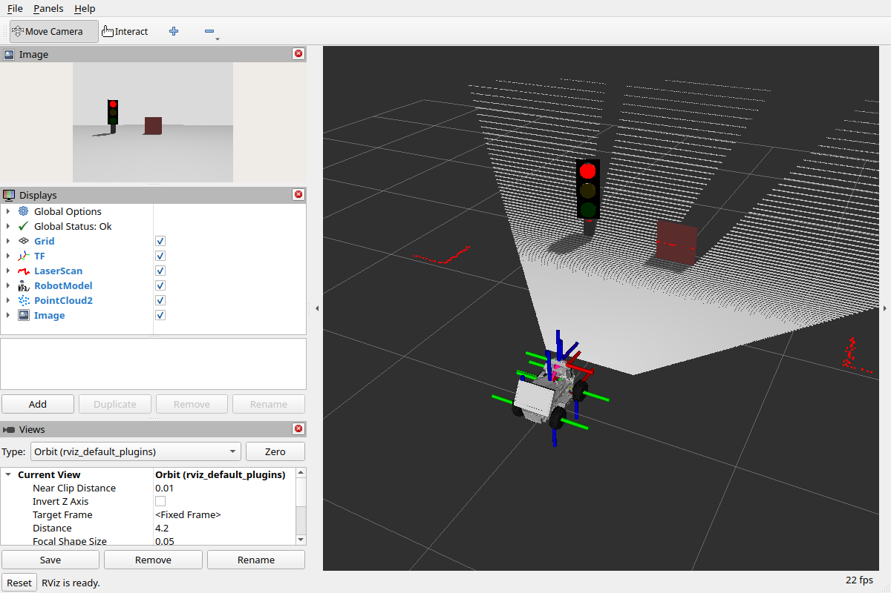
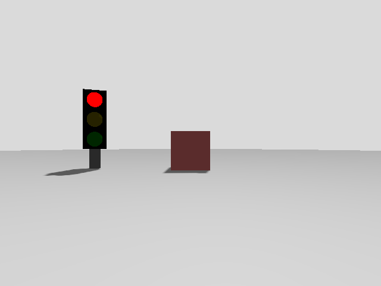

# AI-Self-driving-Car

AgileX LIMO(아커만 조향)를 **ROS 2 Jazzy + Gazebo Harmonic**에서 돌리는 시뮬레이션 환경입니다.
[limo_ros2](https://github.com/JACKSON-KIM-JAEHO/limo_ros2)(`humble_low_Mesh` 브랜치, ROS 2 Humble + Gazebo Classic)를
Ubuntu 24.04 환경으로 옮긴 것입니다.



| | |
|---|---|
| 운영체제 | Ubuntu 24.04 |
| ROS | ROS 2 Jazzy |
| 시뮬레이터 | Gazebo Harmonic (gz-sim 8) |

## 들어 있는 것

| 폴더 | 내용 |
|---|---|
| [`limo_gz`](limo_gz) | 로봇 모델, 센서, 월드, 신호등, launch, 조종 창 |
| [`limo_examples`](limo_examples) | 처음 보는 사람을 위한 예제 노드 3개 (전진, 라이다 읽기, 장애물 앞 정지) |
| [`limo_perception`](limo_perception) | 카메라 인식용 YOLOv8-seg 도구 (프레임 캡처, 데이터셋 병합, 학습, 디버그 뷰어) |

시뮬레이션에서 되는 것:

- **구동**: `/cmd_vel`로 아커만 조향 주행, `/odom`과 TF 발행
- **라이다**: `/scan` (720점, ±120°, 8 Hz, 0.2~8 m)
- **깊이 카메라**: 컬러 이미지, 깊이 이미지, 색이 입혀진 포인트클라우드 (640×480, 10 Hz)
- **IMU**: `/imu` (100 Hz)
- **신호등**: 토픽으로 빨강/노랑/초록/꺼짐 전환
- **조종 창**: 키보드 조종, 신호등 버튼, 카메라 사진 저장

아직 없는 것: 주행용 맵(트랙 등), SLAM, Nav2, 자율주행 로직. 지금 월드는 바닥에 상자 3개와 신호등 1개만 있는 시험용입니다.

## 설치

```bash
sudo apt install -y ros-jazzy-ros-gz ros-jazzy-xacro ros-jazzy-robot-state-publisher \
  ros-jazzy-rviz2 python3-pyqt5 python3-opencv python3-numpy
```

```bash
mkdir -p ~/jaeho_ws/AI-Self-driving-Car/src && cd ~/jaeho_ws/AI-Self-driving-Car/src
git clone https://github.com/novalab0401/AI-Self-driving-Car.git
cd ~/jaeho_ws/AI-Self-driving-Car
source /opt/ros/jazzy/setup.bash
colcon build --symlink-install
```

conda 환경(`base` 포함)이 켜져 있어도 빌드됩니다. `limo_gz`의 `CMakeLists.txt`가 conda 쪽 Python과 Protobuf를 피하도록 되어 있습니다.

## 실행

```bash
cd ~/jaeho_ws/AI-Self-driving-Car
source /opt/ros/jazzy/setup.bash
source install/setup.bash
ros2 launch limo_gz sim.launch.py
```

창이 세 개 뜹니다: Gazebo, RViz, 조종 창(LIMO Dashboard).

| launch 인자 | 기본값 | 뜻 |
|---|---|---|
| `dashboard` | `true` | 조종 창을 같이 띄울지 |
| `rviz` | `true` | RViz를 같이 띄울지 |
| `world` | `empty.sdf` | `limo_gz/worlds` 안의 월드 파일 이름 |

```bash
ros2 launch limo_gz sim.launch.py rviz:=false dashboard:=false   # Gazebo만
```

## 조종 창



**Keyboard Teleop** 버튼을 눌러 ON으로 바꾸고, 이 창을 클릭해 둔 상태에서 키를 누릅니다.

| 키 | 동작 |
|---|---|
| `i` / `,` 누르고 있기 | 전진 / 후진. 떼면 멈춤 |
| `j` / `l` 누르고 있기 | 앞바퀴 왼쪽 / 오른쪽. 떼면 직진 |
| `i` + `j` 같이 | 전진하면서 좌회전 |
| `k` | 정지 |
| `q` / `z` | 최대 속도와 최대 회전 10% 올림 / 내림 |
| `w` / `x` | 최대 속도만 |
| `e` / `c` | 최대 회전만 |

- `j`/`l`은 자동차 핸들처럼 동작합니다. 후진할 때도 `j`는 앞바퀴를 왼쪽으로 꺾습니다.
- 다른 창을 클릭하면 안전을 위해 차가 멈춥니다.
- Teleop이 OFF일 때는 `/cmd_vel`을 보내지 않으므로, 직접 만든 노드의 명령과 겹치지 않습니다.
- 지금 플러그인 설정에서는 속도와 회전이 각각 1.0(m/s, rad/s)에서 잘립니다.

**Camera Capture** 패널은 `/rgb/image_raw` 화면을 PNG로 저장합니다. `Capture Now` 버튼, `P` 키(Capture Hotkey를 ON으로), 일정 간격 자동 촬영 세 가지 방법이 있습니다.

## 신호등



조종 창의 Red / Yellow / Green 버튼을 누르거나, 토픽으로 직접 보냅니다. 시작할 때는 빨간불입니다.

```bash
ros2 topic pub -1 /traffic_light/color std_msgs/msg/String "{data: 'green'}"   # red, yellow, green, off
```

새 월드에 신호등을 넣으려면 `<include>`만 추가하면 됩니다. 렌즈는 모델의 -y 방향을 봅니다.

```xml
<include>
  <uri>model://traffic_light</uri>
  <pose>2.0 0.8 -0.739 0 0 -1.19</pose>
</include>
```

## 센서와 RViz



RViz는 Gazebo 월드가 아니라 **로봇이 센서로 받은 데이터**를 보여 줍니다(위 그림은 보기 좋게 확대한 화면입니다).

- 빨간 점: 라이다(`/scan`). 라이다 높이에서 자른 한 줄입니다.
- 색이 있는 점들: 깊이 카메라의 포인트클라우드(`/depth/points`). 카메라가 본 면만 나타납니다.
- 왼쪽 위: 카메라 화면(`/rgb/image_raw`).

로봇 카메라가 보는 화면:



### 토픽

| 토픽 | 타입 | 내용 |
|---|---|---|
| `/cmd_vel` | `geometry_msgs/Twist` | 주행 명령. `linear.x` [m/s], `angular.z` = 요 각속도 [rad/s] |
| `/odom` | `nav_msgs/Odometry` | 바퀴 오도메트리 (50 Hz) |
| `/tf`, `/tf_static` | | `odom → base_footprint → base_link →` 각 센서 |
| `/joint_states` | `sensor_msgs/JointState` | 바퀴 4개, 조향 2개 |
| `/scan` | `sensor_msgs/LaserScan` | 라이다, frame `laser_link` |
| `/rgb/image_raw` | `sensor_msgs/Image` | 컬러 이미지 (rgb8), frame `depth_link` |
| `/depth/image_raw` | `sensor_msgs/Image` | 깊이 이미지 (32FC1, 미터), frame `depth_link` |
| `/depth/points` | `sensor_msgs/PointCloud2` | 색이 있는 포인트클라우드, frame `depth_camera_link` |
| `/rgb/camera_info`, `/depth/camera_info` | `sensor_msgs/CameraInfo` | 카메라 내부 파라미터 |
| `/imu` | `sensor_msgs/Imu` | IMU, frame `imu_link` |
| `/traffic_light/color` | `std_msgs/String` | 신호등 색 (보내는 쪽) |

`/cmd_vel`의 `angular.z`는 조향각이 아니라 **차가 도는 속도**입니다. 그래서 같은 `angular.z`라도 후진할 때는 앞바퀴가 반대로 꺾입니다(실물 LIMO 드라이버도 같습니다). 조종 창은 이 차이를 대신 처리해 줍니다.

## 예제 노드

시뮬레이션을 띄운 뒤 다른 터미널에서 실행합니다. 코드에 설명이 자세히 달려 있어서, 복사해서 고쳐 쓰기 좋습니다.

```bash
ros2 run limo_examples cmd_vel_publisher_example   # 0.15 m/s 로 전진
ros2 run limo_examples scan_subscriber_example     # 정면 거리와 가장 가까운 장애물 거리 출력
ros2 run limo_examples obstacle_stop_example       # 전진하다가 정면 0.4 m 안에 장애물이 오면 정지
```

## 카메라 인식 (YOLOv8)

[`limo_perception/README.md`](limo_perception/README.md)에 사진 찍기 → 라벨링 → 데이터셋 병합 → 학습 → 결과 확인 순서가 있습니다.
`data/`와 `models/`는 비어 있습니다. 맵을 새로 만든 뒤 그 맵에서 다시 찍고 학습합니다.

```bash
pip install ultralytics      # 학습과 디버그 뷰어에 필요
```

## 알아 둘 점

- **명령이 끊겨도 차는 계속 달립니다.** 시뮬레이터의 구동 플러그인에는 명령 타임아웃이 없어서 마지막 `/cmd_vel`을 계속 따릅니다. 노드를 끝낼 때는 정지 명령(`Twist()`)을 보내야 합니다. 예제 노드와 조종 창은 그렇게 합니다.
- **회전 중에는 `/odom` 위치가 실제와 벌어집니다.** 3초 회전에 약 0.13 m 차이가 납니다(방향은 거의 맞습니다). 직진에서는 일치합니다.
- **속도·가속도 한계와 조향 게인은 임시값입니다.** 실물 LIMO로 맞춘 값이 아닙니다. `limo_gz/urdf/ackermann.xacro`의 플러그인 설정에 있습니다.
- **`cv_bridge`는 쓰지 않습니다.** pip로 설치한 NumPy 2.x(ultralytics와 함께 깔림)와 같이 쓰면 `cv_bridge`가 죽기 때문에, 이 레포의 노드는 이미지를 NumPy로 직접 변환합니다. 직접 만드는 노드에서도 같은 문제가 날 수 있습니다.
- **새 월드를 만들 때** 월드 파일에 `gz-sim-sensors-system`(라이다, 카메라)과 `gz-sim-imu-system`(IMU) 플러그인이 있어야 센서가 동작합니다. `limo_gz/worlds/empty.sdf`를 참고하세요.

## 출처

로봇 모델과 메시는 [agilexrobotics/limo_ros2](https://github.com/agilexrobotics/limo_ros2)(Apache-2.0)의 `limo_car` 패키지에서 왔고,
[JACKSON-KIM-JAEHO/limo_ros2](https://github.com/JACKSON-KIM-JAEHO/limo_ros2)의 `humble_low_Mesh` 브랜치를 거쳤습니다.
무엇을 어떻게 바꿨는지는 [`limo_gz/NOTICE.md`](limo_gz/NOTICE.md)에 있고, 소스에서는 바꾼 곳마다 `[GZ]` 주석을 달았습니다.
